  

### Hi, I'm Rivindu 👋

I'm a software engineer in Sri Lanka working across **applied AI**, **full-stack product engineering** and **infrastructure**. I like taking an idea all the way from a model or a schema to something running in production.

- 🛒 **Now:** building the platform behind an MTG / TCG marketplace — NestJS, Prisma, PostgreSQL, Redis and React on AWS
- 🎮 **Research:** adaptive game narrative — reinforcement learning and RAG-grounded LLMs that rewrite quests around how you play
- 🖥️ **Side quests:** self-hosting everything on a VPS behind Traefik, and shipping desktop apps for small businesses

## Selected work

<table>
  <tr>
    <td width="50%" valign="top">
      <h3><a href="https://github.com/Rivi9/PharmaPOS">💊 PharmaPOS</a></h3>
      
Offline-first desktop point of sale for pharmacies: barcode checkout, shifts, stock and expiry warnings, receipt printers, Google Drive backups and AI sales insights.

      <code>Electron</code> · <code>React</code> · <code>TypeScript</code> · <code>SQLite</code> · <code>Drizzle</code>
    </td>
    <td width="50%" valign="top">
      <h3><a href="https://github.com/Rivi9/dynamic-quest-gen-full">🧭 Dynamic Quest Generator</a></h3>
      
Unity plugin that personalises RPG narrative in real time. It profiles players from gameplay telemetry, detects flow state, and picks and writes quests with PPO and a local LLM.

      <code>Unity</code> · <code>C#</code> · <code>FastAPI</code> · <code>XGBoost</code> · <code>Ollama</code>
    </td>
  </tr>
  <tr>
    <td width="50%" valign="top">
      <h3><a href="https://github.com/Rivi9/Laptop-Recommendation-System">💻 Laptop Recommender</a></h3>
      
Recommends laptops from a user's occupation and needs, with NLP over free-text requirements and a Flask front end.

      <code>Python</code> · <code>NLP</code> · <code>Flask</code> · <code>Jupyter</code>
    </td>
    <td width="50%" valign="top">
      <h3><a href="https://github.com/Rivi9/Adult-Census-Income-Prediction">📊 Income Prediction</a></h3>
      
Classifies income bracket from US census data, comparing Naive Bayes and Random Forest models.

      <code>Python</code> · <code>scikit-learn</code> · <code>Jupyter</code>
    </td>
  </tr>
</table>

## Toolchain

| | |
|---|---|
| **AI & data** |      |
| **Backend** |       |
| **Frontend & apps** |       |
| **Infra & DevOps** |      |

## Activity

  
  

